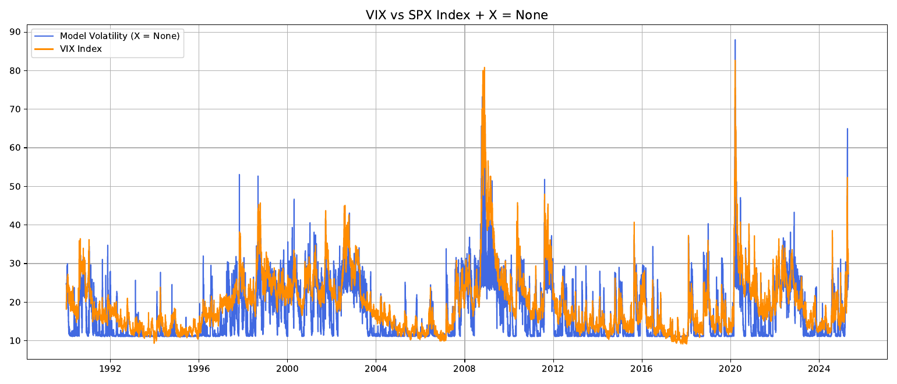
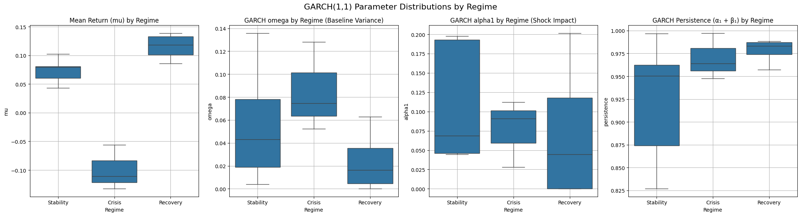
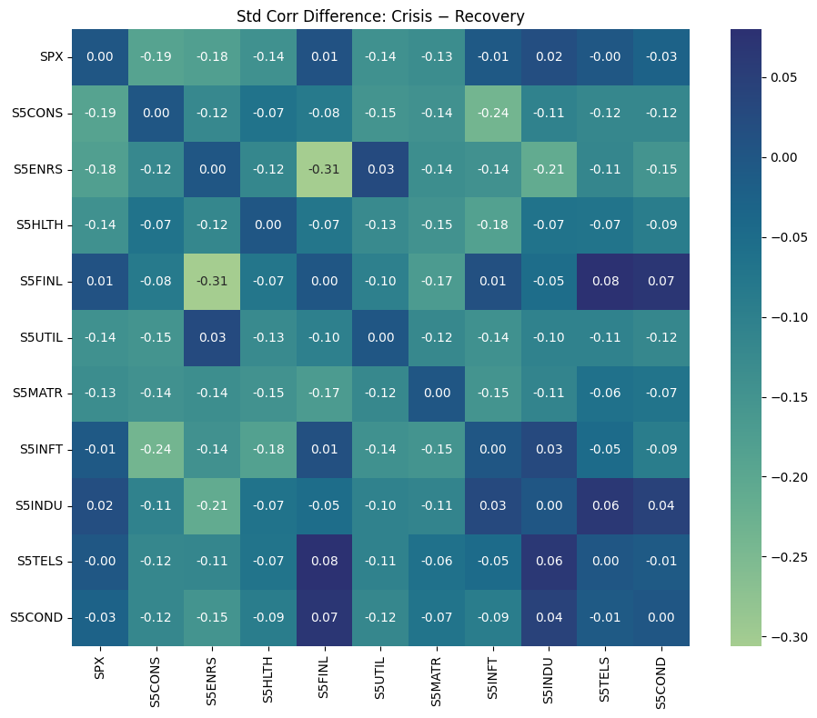
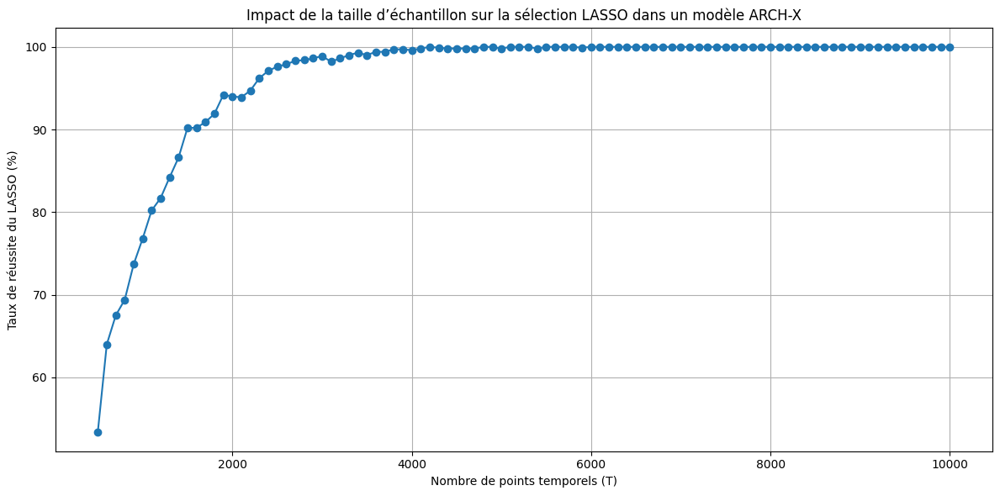

# Regime Study of ARCH/GARCH Volatility Models

**Research internship · CREST – ENSAE (Institut Polytechnique de Paris) · Summer 2025**
Supervisor: **Raphaël Thabut (PhD)**

Do volatility dynamics really change between *stability*, *crisis* and *recovery* periods, and is that strong enough to justify a **Markov-switching ARCH model with exogenous variables (MS-ARCH-X)**? This project tests the question on the S&P 500, its 10 GICS sector indices and other major indices from 1990 to 2025.

📄 **[Read the full report (PDF)](report/internship_report.pdf)** · 📓 **[Main notebook](notebooks/01_regime_garch_analysis.ipynb)**

<p align="center">
  <br>
  <em>Volatility from the fitted MS-ARCH model compared with the VIX, S&P 500, 1990–2025.</em>
</p>

---

## What I did

| # | Analysis | Method | Main result |
|---|---|---|---|
| 1 | **MS-ARCH-X on the S&P 500** | EM calibration of a Markov-switching ARCH with exogenous drivers (VIX, rates, commodities…) | The model's volatility follows the VIX closely, including the 2008 and 2020 spikes |
| 2 | **Regime-based ARCH(1) / GARCH(1,1)** | Separate fits on 15 historical sub-periods labelled Stability / Crisis / Recovery | Crisis periods have negative mean returns and a higher baseline variance ω; Recovery periods have the highest persistence (α₁+β₁) |
| 3 | **Regime-aware GARCH + residual diagnostics** | One GARCH per regime, standardised residuals, test of asymmetry between positive and negative returns | Residuals alone **don't** clearly separate the regimes, so cross-sectional information is needed |
| 4 | **Sector correlation structure** | Raw vs GARCH-standardised correlation matrices per regime, rolling correlations | Crises bring **stronger and more uniform** correlations across sectors; standardising for volatility makes this clearer |
| 5 | **Local GARCH standardisation** | GARCH fitted separately on each regime window | Confirms that the correlation differences are structural and not caused by volatility levels |
| 6 | **Unsupervised regime discovery** | K-means on (20-day return, 20-day volatility) features | Without any labels, K-means recovers the Crisis and Recovery regimes |
| 7 | **GARCH parameters across indices** | Fits on every (index × regime) pair | Many realisations per regime give a far more robust picture than the SPX alone |
| 8 | **LASSO variable selection in ARCH-X** *(ongoing)* | Monte-Carlo simulation, 2,000 trials for each sample size | 99.9% correct selection at T = 5,000; above 95% once T ≳ 2,000 |

<p align="center">
  <br>
  <em>GARCH(1,1) parameters (μ, ω, α₁, α₁+β₁) by regime, S&P 500 sub-periods.</em>
</p>

<p align="center">
  
  <br>
  <em>Left: change in standardised sector correlation, Crisis − Recovery. Right: LASSO selection success rate against sample size T in an ARCH-X model.</em>
</p>

---

## Repository structure

```
├── report/
│   └── internship_report.pdf        # full technical report (19 pages)
├── notebooks/
│   ├── 01_regime_garch_analysis.ipynb   # ★ main notebook: reproduces sections 1–7 of the report
│   ├── 02_lasso_arch_x.ipynb            # LASSO variable selection in ARCH-X (Monte Carlo)
│   ├── 03_ms_archx_simulation.ipynb     # simulate and re-estimate an MS-ARCH-X model
│   └── exploratory/                     # earlier working notebooks (regimes, correlations, MS-ARCH)
├── src/
│   └── functions_jules.py           # all my helper functions (data loading, regime labelling, GARCH fits, plots)
├── supervisor_code/                 # MS-ARCH-X implementation and EM algorithm by R. Thabut, used as the base
├── data/                            # S&P 500, sector indices, VIX & macro series, regime labels
├── figures/                         # figures used in this README
└── requirements.txt
```

## Getting started

```bash
git clone https://github.com/julesFrealle/Regime_Study--ARCH-Volatility-Modelling-Research-Internship-.git
cd Regime_Study--ARCH-Volatility-Modelling-Research-Internship-
pip install -r requirements.txt
jupyter lab notebooks/01_regime_garch_analysis.ipynb
```

Every notebook starts with a short path-setup cell, so it finds `data/`, `src/` and `supervisor_code/` from wherever it is launched.

## Tech stack

`Python` · `arch` · `statsmodels` · `scikit-learn` · `scipy` · `pandas` · `numpy` · `matplotlib` / `seaborn` / `plotly`

## Acknowledgements

This work was carried out at **CREST–ENSAE (Paris-Saclay)** as part of the Bachelor of Science at École Polytechnique, under the supervision of **Raphaël Thabut (PhD)**. The MS-ARCH-X class, the EM calibration routine and the notebooks in `supervisor_code/` were written by him and are included with credit.

**References**
- M. Ataei, *Modeling Regime Structure and Informational Drivers of Stock Market Volatility via the Financial Chaos Index*.
- L. Cerboni Baiardi, M. Costabile, D. De Giovanni, F. Lamantia, A. Leccadito et al., *The Dynamics of the S&P 500 under a Crisis Context: Insights from a Three-Regime Switching Model*, Risks (MDPI).
